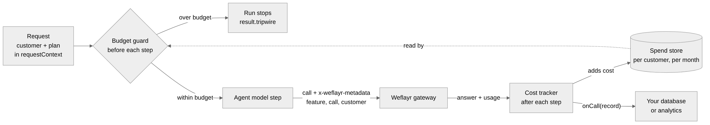

# mastra-weflayr

Send a [Mastra](https://mastra.ai) agent's model calls through the
[Weflayr](https://weflayr.com) gateway, tagged with the customer they are for,
and stop a customer's run once they have used their monthly AI budget.

If you build a product on Mastra and your customers share your agents, you
probably want to know three things: which customer is costing you what, whether
a cheaper model would do the same job, and how to stop one customer from running
up a bill. Mastra gives you the agent, memory and tracing. Weflayr is a gateway
that records every model call and can replay your real calls on other models to
compare cost and quality, but it can only do that if each request says which
feature, which call and which customer it belongs to. This package puts that
information on every request for you, and adds a budget check and a running
cost total per customer inside your Mastra app.



## What you get

- **Cost per customer.** Every request carries the customer, call name, feature,
  plan and run id. Weflayr groups cost by them, and `onCall` hands you the same
  numbers in your own code after every step.
- **A hard budget.** Give a customer a monthly dollar budget. Their next step is
  stopped before the model is called, with a `tripwire` on the result you can
  turn into an upgrade prompt. Other customers carry on. It also stops a tool
  loop part way through.
- **Named calls.** Each agent has a fixed call name, so Weflayr can replay that
  call's real traffic on other models and score the answers.
- **Fallback that is priced correctly.** Put a direct model after the gateway in
  Mastra's model list. If the gateway fails, Mastra moves on, and the step is
  priced as the model that answered.
- **No new infrastructure.** One file of glue on top of Mastra's own model and
  processor hooks. Nothing to deploy.

## Why this is useful in a Mastra app

Mastra already traces runs and reports token usage, and that is the right place
to debug a single run. What a multi-tenant product usually adds on top is
attribution (this run was for customer X, on plan Y) and a limit (customer X may
spend $25 a month). People in the Mastra community have asked for pieces of
that: per-user cost tracking
([#5703](https://github.com/mastra-ai/mastra/issues/5703)), governance middleware
with a cost cap ([#17606](https://github.com/mastra-ai/mastra/issues/17606)), a
token budget ([#27050](https://github.com/mastra-ai/mastra/issues/27050)),
an attempt-scoped model budget
([#23242](https://github.com/mastra-ai/mastra/issues/23242)) and a spend cap
integration ([#28679](https://github.com/mastra-ai/mastra/issues/28679)). This
package is one way to get the customer tag and the budget stop today, using
Mastra's request context and processors as they are, without changing Mastra.
It does not replace Mastra's tracing, and it does not claim to settle those
issues.

## Install

```sh
npm install mastra-weflayr
```

You need `@mastra/core` 1.34 or later and Node 22.13 or later. Create a Weflayr
key at [app.weflayr.com](https://app.weflayr.com) and set it:

```sh
export WEFLAYR_API_KEY=<your Weflayr key>
```

You do not need a key from the model provider. The gateway uses its own.

## Use it

```ts
import { Agent } from "@mastra/core/agent";
import { Weflayr } from "mastra-weflayr";

const weflayr = new Weflayr({
  // Which feature each call belongs to. Keep call names stable.
  features: { "classify-ticket": "support" },
  // Dollars per million tokens, from your provider's price list.
  prices: { "claude-haiku-5-5": { inputPerMillion: 0.1, outputPerMillion: 0.5 } },
  // A monthly budget in dollars per customer. Return nothing for no limit.
  budget: (customer) => plans.budgetFor(customer),
});

export const classifier = new Agent({
  id: "classify-ticket",
  name: "Ticket classifier",
  instructions: "Classify the ticket as billing, bug or question.",
  ...weflayr.agent({ call: "classify-ticket", model: "claude-haiku-5-5" }),
});
```

`weflayr.agent()` returns the model and the processors for one agent. Spread it
into `new Agent({ ... })`.

Say who each run is for with the request context:

```ts
const result = await classifier.generate(ticketText, {
  requestContext: weflayr.context({ customer: "plausible", plan: "pro" }),
});

if (result.tripwire?.metadata?.type === "weflayr-budget") {
  // result.tripwire.metadata: { customer, month, limitUsd, spentUsd }
  return showUpgradePrompt(result.tripwire.reason);
}
```

If you already pass Mastra's resource id for memory, the customer defaults to
it, so you may not need to set anything.

The same run shows up in Weflayr under the feature `support`, the call
`classify-ticket` and the customer `plausible`.

## Options

| Option           | What it does                                                                                   |
| ---------------- | ---------------------------------------------------------------------------------------------- |
| `apiKey`         | Defaults to `WEFLAYR_API_KEY`                                                                  |
| `features`       | Call name to feature name. Unlisted calls use `defaultFeature` (default `"other"`)             |
| `prices`         | Dollars per million tokens by model id                                                         |
| `customer(rc)`   | Who the run is for. Default: the `weflayr-customer` context key, then Mastra's resource id     |
| `plan(rc)`       | The customer's plan, sent to Weflayr as a tag                                                  |
| `budget(c, rc)`  | Monthly dollars for a customer, or nothing for no limit                                        |
| `spend`          | Where spend is kept. Default is in memory, see below                                           |
| `onCall(record)` | Called after every step with customer, call, model, tokens and cost                            |
| `onBudgetError`  | `"allow"` (default) runs the step if the budget check fails, `"block"` stops it                |

Pieces you can use on their own: `weflayr.model()`, `weflayr.config()` (a fixed
config for a scorer's judge model, where there is no request context),
`weflayr.budgetGuard()`, `weflayr.modelCapture()`, `weflayr.costTracker()`,
`weflayr.budget(customer)` and `weflayr.estimateCost()`.

### Pick the model by plan

```ts
...weflayr.agent({
  call: "draft-reply",
  model: (rc) => (rc.get("weflayr-plan") === "pro" ? "claude-opus-5-5" : "claude-haiku-5-5"),
}),
```

### Keep a call alive if the gateway fails

```ts
const reply = new Agent({
  id: "reply",
  name: "Reply",
  instructions: "…",
  model: [
    { model: weflayr.model("claude-haiku-5-5", { call: "reply" }), maxRetries: 1 },
    { model: "anthropic/claude-haiku-5-5", maxRetries: 1 },
  ],
  inputProcessors: [weflayr.budgetGuard(), weflayr.modelCapture()],
  outputProcessors: [weflayr.costTracker({ call: "reply", model: "claude-haiku-5-5" })],
});
```

If the gateway fails, Mastra tries the next model. Calls that go direct do not
appear in Weflayr, but they are counted in the customer's spend if the model is in `prices`.

## Spend and budgets

Spend is tokens times your `prices` table, added up per customer per UTC
calendar month. Weflayr's dashboard is the source of truth for what you were
billed. Use this number to compare customers and to enforce budgets.

The default `MemorySpendStore` lives in the process. It resets on restart and is
not shared between servers, so it is for development and single-server apps. For
production, pass a store backed by your database:

```ts
import type { SpendStore } from "mastra-weflayr";

const spend: SpendStore = {
  get: async (customer, month) => (await db.spend.find(customer, month)) ?? 0,
  add: async (customer, month, usd) => db.spend.increment(customer, month, usd),
};
new Weflayr({ spend, /* … */ });
```

Make `add` an atomic increment. If you build on Convex, the
[convex-weflayr](https://www.npmjs.com/package/convex-weflayr) component keeps
the same numbers in Convex tables.

## Limitations

- The budget is checked before each step and spend is added after it, so a step
  already running can push a customer past the limit.
- Cost is an estimate. A model that is not in `prices` is recorded with cost 0.
- The default spend store is per process.
- Exact pricing of a fallback model needs `modelCapture()`, which `agent()`
  includes. If you assemble the processors by hand, add it.
- Calls that do not go through a Mastra agent are not seen.
- Customer ids are sent to Weflayr as written. Use an id, not an email address.

## Troubleshooting

**Nothing shows in Weflayr.** The agent's model is not the one from
`weflayr.model()`. Check that you spread `weflayr.agent(...)` last, so nothing
overrides `model`.

**Cost is $0.** The model is missing from `prices`. Add it, in dollars per
million tokens.

**A budget never stops anyone.** The budget needs `prices`, because spend is
priced from them, and a customer, from the request context or the resource id.

**`WEFLAYR_API_KEY is not set`.** Set it, or pass `apiKey`.

**The gateway returns 402.** Your Weflayr balance is empty.

## Try it

```sh
npm install
WEFLAYR_API_KEY=<your key> npm run example
```

`examples/live.ts` classifies one ticket for two customers, then gives one a tiny
budget and shows the next run being stopped before the model is called.

## Contributing

```sh
npm install
npm test
npm run lint
npm run typecheck
npm run build
```

See [CONTRIBUTING.md](./CONTRIBUTING.md), [docs/ARCHITECTURE.md](./docs/ARCHITECTURE.md)
and [docs/OPERATIONS.md](./docs/OPERATIONS.md). To publish, see
[PUBLISHING.md](./PUBLISHING.md). Changes are in [CHANGELOG.md](./CHANGELOG.md).

## License

Apache-2.0
